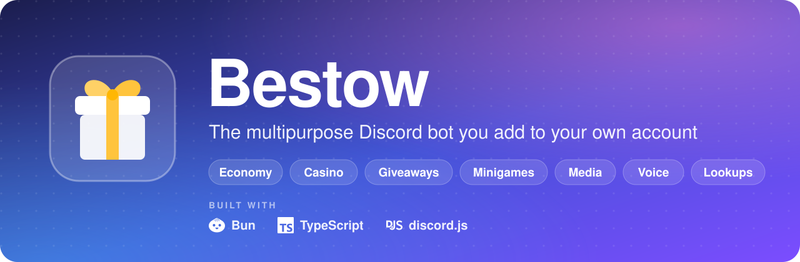

<h1 align="center">
  <a href="https://discord.com/oauth2/authorize?client_id=1553093201496375407"></a>
</h1>

<p align="center">
  <a href="https://discord.com/oauth2/authorize?client_id=1553093201496375407"></a>
  <a href="https://bun.sh"></a>
  <a href="https://www.typescriptlang.org"></a>
  <a href="https://discord.js.org"></a>
  <a href="LICENSE"></a>
</p>

<p align="center">
  <b>A free, open-source Discord bot you add to your own account.</b><br>
  Use it in any server, DM or group chat — nobody has to add it to a server first.
</p>

<p align="center">
  <a href="#-add-bestow-to-discord"><b>Add to Discord</b></a> &nbsp;•&nbsp;
  <a href="#-features"><b>Features</b></a> &nbsp;•&nbsp;
  <a href="#-reposts"><b>Reposts</b></a> &nbsp;•&nbsp;
  <a href="COMMANDS.md"><b>All commands</b></a> &nbsp;•&nbsp;
  <a href="#-privacy-by-design"><b>Privacy</b></a> &nbsp;•&nbsp;
  <a href="#-run-your-own-copy"><b>Self-host</b></a> &nbsp;•&nbsp;
  <a href="#-development"><b>Contribute</b></a>
</p>

<table>
<tr>
<td width="25%" valign="top" align="center">

**🧩 All in one**

Economy, casino, giveaways, games, media editing, free voices, AI, lookups and reposts.

</td>
<td width="25%" valign="top" align="center">

**👤 Works anywhere**

Install it on your account and use it in servers, DMs and group chats.

</td>
<td width="25%" valign="top" align="center">

**🔒 Private by design**

No tracking and no data selling. `/privacy` shows, exports and erases what it stores.

</td>
<td width="25%" valign="top" align="center">

**📖 Open source**

TypeScript, Bun and discord.js under GPL-3.0. Every command is in [COMMANDS.md](COMMANDS.md).

</td>
</tr>
</table>

## 🚀 Add Bestow to Discord

<div align="center">
<table>
<tr>
<td align="center">
<br>
<a href="https://discord.com/oauth2/authorize?client_id=1553093201496375407"></a>
<br><br>
<a href="https://discord.com/oauth2/authorize?client_id=1553093201496375407&integration_type=1&scope=applications.commands"></a>
&nbsp;
<a href="https://discord.com/oauth2/authorize?client_id=1553093201496375407&scope=bot+applications.commands&permissions=1374812499030"></a>
<br>
<sub>Free · nothing to host · works in servers, DMs and group chats</sub>
<br><br>
</td>
</tr>
</table>
</div>

<table>
<tr>
<th width="50%">👤 Add it to your account</th>
<th width="50%">🏠 Add it to a server as well</th>
</tr>
<tr>
<td valign="top">

- Use it anywhere, with no admin needed
- Not tied to one server
- Economy, games, media, lookups and tools all work this way

</td>
<td valign="top">

- Unlocks what only a server bot can do: giveaways, levels and XP, `/config` and `/server` settings
- Features that react to what happens in a channel
- Those commands tell you when the bot isn't in the server

</td>
</tr>
</table>

## ✨ Features

<table>
<tr>
<td colspan="2" valign="top">

### 📰 Reposts &nbsp;<sub>`/repost` · `/x repost` · `/instagram repost` · `/tiktok repost`</sub>

Paste a link from **X, Instagram, TikTok, Bluesky, Threads, Facebook, Reddit or Mastodon** (or YouTube, Twitch, Vimeo and other video sites) and get a full card:

- 👤 the author, caption and when it was posted
- ❤️ likes, comments, shares and views
- 🎞️ photos and videos that play right in Discord
- 🌐 an automatic translation when the post is in another language than yours

[How each site is read →](#-reposts)

</td>
</tr>
<tr>
<td colspan="2" valign="top">

### 💬 Group chats &nbsp;<sub>`/community` · `/timezone everyone`</sub>

The same commands work in servers, DMs and group chats: each one works out where it was run, so there's no separate group-chat version to remember. In group chats Discord lets Bestow answer commands and buttons but not read or post on its own, so each of these is a panel everyone presses:

- 🕒 **Time board** (`/timezone everyone`): everyone's local time, grouped by clock. **Add me** asks for your timezone once
- 🎂 **Birthday board** (`/community birthday list`): who's next and who's today. Save yours once, then add it to each chat with one press. In a server, `/server birthdays panel` posts one that keeps itself up to date
- 📅 **Plans** (`/community plan new`): type `friday 8pm` and everyone sees it in their own timezone, answers Going / Maybe / Can't, and can get a reminder 15 minutes before
- 📝 **Shared lists** (`/community list`): groceries, movies, packing. Anyone adds and ticks things off
- 🎉 **Party games** (`/community party`): truth or dare, never have I ever and would you rather with button votes, plus `pick` for "where should we eat?"
- Reputation, reminders and free-game lookups work in group chats too (reminders arrive by DM there)

</td>
</tr>
<tr>
<td width="50%" valign="top">

### 💰 Economy &nbsp;<sub>`/eco` · `/eco-company`</sub>

- A wallet card you restyle in a live **studio**
- Bank, daily and monthly rewards, work, hustle, beg and bonus
- Robbing, and mob protection against it
- Businesses, labs, investments, quests and trading cards
- **Companies** with shared vaults and projects
- Amounts like `all`, `half` or `10k`, with race-safe balances

</td>
<td width="50%" valign="top">

### 🎰 Casino &nbsp;<sub>`/eco games`</sub>

- Blackjack, roulette, slots, crash and plinko
- Video poker, scratch cards, mines, towers and ladder
- Higher-or-lower, dice, high roll and coin flip
- A progressive jackpot and odds explainers
- Lifetime stats and per-game leaderboards

</td>
</tr>
<tr>
<td width="50%" valign="top">

### 🎁 Giveaways &nbsp;<sub>`/giveaway` · `/eco giveaway`</sub>

- Button entry that survives restarts
- Fair rerolls: nobody wins twice until everyone who entered has
- Coin-funded pots held in escrow (25% tax on payout, refunded if cancelled)

</td>
<td width="50%" valign="top">

### 🎮 Games &nbsp;<sub>`/games` · `/guess` · `/community guess`</sub>

- Tic-tac-toe, rock-paper-scissors, head-to-head blackjack, snake and a cookie race
- Played with buttons, against a friend or whoever presses Join
- A **movie, TV, video-game and song guessing game** that runs until someone presses Stop

<details>
<summary>Guessing in DMs, group chats and servers</summary>

- **DMs:** just type your guesses.
- **Group chats:** Discord doesn't let a user-installed bot read messages, so answer with `/guess <answer>` or a button. Guesses, hints and skip votes are cleared at the end of each round, and the finished round deletes itself after 5 minutes.
- **Servers with Bestow as a server bot:** an admin can give the game its own channel (`/server guess setup`) and guesses are typed there, as they were in TMCBot.

</details>

</td>
</tr>
<tr>
<td width="50%" valign="top">

### 🎬 Media &nbsp;<sub>`/media` · `/audio` · `/download`</sub>

- Dozens of image, GIF and video effects
- Animated [MakeSweet](https://makesweet.com) scenes (billboard, flag, Rubik's cube, heart locket…)
- Audio effects, frame extraction, `/gif` and `/voicemessage`
- `/download` and `/soundcloud` fetch from YouTube, TikTok, X, Reddit, SoundCloud and more
- `/shazam` or right-click **Identify Song** recognises music

</td>
<td width="50%" valign="top">

### 🗣️ Voice &nbsp;<sub>`/tts`</sub>

- Free local voices (Kokoro, with Microsoft Edge voices as the online fallback)
- Character voices and singing voices
- Optional ElevenLabs voices, and AI singers through an ACE-Step server you run
- Sent as a file or as a Discord **voice message**

</td>
</tr>
<tr>
<td width="50%" valign="top">

### 🤖 AI &nbsp;<sub>`/ai` · @mention · DMs</sub>

- Chat with **Reply n/3** conversations, plus a second model (`/ai llama`)
- Image generation and editing (`/ai imagine`, `edit-imagine`) and Perplexity web search
- Your own **custom AI**, personas and opt-in memory
- Image reading, transcripts, summaries, fact-checks and geolocation (never addresses or homes)
- Right-click **AI Tools**, **Transcribe Audio** and **Translate Message**
- Any OpenAI-compatible provider, including local ones. 20 requests an hour free; Premium removes the limit

</td>
<td width="50%" valign="top">

### 🔎 Lookups

- **Games:** `/roblox` `/rolimons` `/minecraft` `/fortnite` `/valorant` `/steam`
- **Social:** `/instagram` `/tiktok` `/x` `/twitch` `/youtube` `/snapchat` `/telegram` `/pinterest` `/medaltv` `/cashapp` `/bio` `/github` `/get`
- **Music:** `/lastfm` `/spotify` `/lyrics`
- **Crypto:** `/crypto` `/ton`

</td>
</tr>
<tr>
<td width="50%" valign="top">

### 🧰 Utility

- **Words:** `/translate` `/badtranslate` `/define` `/search` `/markov-chain`
- **Tools:** `/qr` `/color` `/convert` `/math` `/base64` `/paste` `/tags` `/timezone` `/ping`
- **Web:** `/dns` `/ip` `/website` (screenshots, scrolling videos, source downloads) `/bypass`
- **Discord:** `/discord` `/avatar` `/banner`, quote images (`/quotemessage`, right-click **Quote Message**) and right-click **View Profile**

</td>
<td width="50%" valign="top">

### 🎉 Fun

- Anime action GIFs (`/action`), `/ship`, `/rate`, `/rating`, `/rizz`, `/roast`, `/petpet`, `/emojimix`
- `/asciify`, `/say`, `/urban`, `/8ball`, `/coinflip`, `/nitro`, a fictional `/juul` and `/button`
- Right-click **Pet User**, **Rizz User** and **Roast User**
- `/generate`: fake Discord messages, replies, reports and more in Discord's own style (each marked as not real), plus Among Us cards, Spotify lyrics and a tier-list builder

</td>
</tr>
<tr>
<td width="50%" valign="top">

### 🫂 Community & server tools &nbsp;<sub>`/community` · `/config` · `/server`</sub>

- Levels, reputation, birthdays, reminders and self-assignable roles
- Weather, trivia, a free-game tracker, weekly and yearly rewards and the item shop
- Counting, starboard, stats channels, sticky messages, level and reaction roles
- Streaming announcements, the server economy and daily lottery, and `/pingonjoin`
- `/serverprofile` sets the bot's avatar, banner, bio and nickname in your server

</td>
<td width="50%" valign="top">

### 💎 Premium & ℹ️ Info &nbsp;<sub>`/premium` · `/help`</sub>

- **Premium:** unlimited AI, no personal daily ElevenLabs limit, and the commands marked ✨ in [COMMANDS.md](COMMANDS.md) (wallet-card styling, the monthly reward, video effects, `/ai imagine`, custom AIs, Instagram lookups, website downloads…)
- Sold through Discord itself, with gift codes and owner grants
- **Info:** `/help` `/about` `/invite` `/plus` `/me` `/donate` `/customize` `/getbotinvite` `/serveravatar` `/serverbanner`

</td>
</tr>
</table>

<p align="center">
  <a href="COMMANDS.md"></a>
</p>

## 📰 Reposts

`/repost <url>` works out the site from the link. `/x repost`, `/instagram repost`, `/tiktok repost` and `/medaltv repost` use the same readers.

| Site | Where the post comes from | Setup |
|---|---|---|
| **X** | [FxTwitter](https://github.com/FxEmbed/FxEmbed) | — |
| **Instagram** | [OGInstagram](https://github.com/seirenkr/OGInstagram), then [Instaloader](https://github.com/instaloader/instaloader), then yt-dlp | Optional Instaloader login (see below) |
| **TikTok** | [fxTikTok](https://github.com/okdargy/fxTikTok) (tnktok.com), then TikWM | — |
| **Bluesky** | Bluesky's public API | — |
| **Threads** | The post's own page (best effort: Threads sometimes asks servers to log in) | — |
| **Facebook** | [facebed](https://github.com/seriaati/facebed), with yt-dlp for videos | — |
| **Reddit** | Reddit's own data; videos with sound go through yt-dlp | A free Reddit app if Reddit blocks your server |
| **Mastodon & the fediverse** | The server's own API (Mastodon, Pleroma, Akkoma, GoToSocial, Truth Social…) | — |
| **YouTube, Twitch, Vimeo, Streamable, Dailymotion, Bilibili, Imgur, Pinterest, Tumblr, Kick, Medal** | yt-dlp | — |

- ⚡ **Fast:** where the media links keep working (Instagram, TikTok, Bluesky…), the card goes out at once with them and is swapped for uploaded copies of whatever fits the upload limit.
- 🌐 **Translated:** a post in another language than the one you read Discord in gets a Google Translate translation under it. `/repost translate:false` skips it once; `REPOST_TRANSLATE=off` turns it off for the whole bot.

## 🔒 Privacy by design

<table>
<tr>
<th width="50%">✅ What Bestow stores</th>
<th width="50%">🚫 What it never stores</th>
</tr>
<tr>
<td valign="top">IDs, settings, game progress and things you deliberately enter (a reminder, a birthday, a wallet style, a plan or a shared-list item).</td>
<td valign="top">A log of chat messages, DMs, emails, phone numbers or IP addresses.</td>
</tr>
</table>

- 🔒 **`/privacy`** shows the policy, what it has on you, a full JSON export and erase-everything. **`/settings`** manages the rest.
- 💬 Message content is read in memory only by the features that need it (counting, XP counters, @mention chat), then discarded.
- 🧠 The AI never reads channel history. Chat uses only its own reply chain, memory is **off by default**, and conversations live in memory for 30 minutes without touching the disk.
- 🧪 Every table that identifies a person is listed in `src/privacy/registry.ts`, and **a test fails if one is added without being registered**, so `/privacy export` and `/privacy delete` can't miss data.
- 📡 The *Presence* intent is off unless you opt in, and there is no telemetry.
- 🌐 Commands that call outside services send only what you typed into that command (listed in `/privacy policy`).

## 🏠 Run your own copy

> [!TIP]
> You only need this to host Bestow yourself. To just use it, [add the hosted bot](https://discord.com/oauth2/authorize?client_id=1553093201496375407).

**Quick start with Docker:**

```bash
git clone https://github.com/Geckomacabre/Bestow-Bot.git && cd Bestow-Bot
cp .env.example .env            # fill in TOKEN and CLIENT_ID (step 1 below)
docker compose up -d --build
```

To update later: `git pull && docker compose up -d --build`. Commands are registered on every start (Discord can take a little while to show new ones).

**Let it update itself (Windows):** `powershell -ExecutionPolicy Bypass -File .\scripts\install-auto-update.ps1` adds a hidden scheduled task that checks GitHub every 5 minutes and, when `main` has new commits, pulls them and rebuilds. It never overwrites your own changes, logs to `logs\auto-update.log`, and `-Uninstall` removes it.

### 1. Create the Discord application

1. Open <https://discord.com/developers/applications> → **New Application**.
2. **Installation** tab: enable **User Install** and **Guild Install**. For a plain `https://discord.com/oauth2/authorize?client_id=<CLIENT_ID>` link that asks "account or server?", set **Install Link** to *Discord Provided Link* and give Guild Install the `applications.commands` and `bot` scopes.
3. **Bot** tab → **Reset Token** → copy it (it's shown once). Under *Privileged Gateway Intents* turn on **Message Content** and **Server Members**. Leave *Presence* off unless you want streaming announcements (then turn it on and set `ENABLE_PRESENCE_INTENT=1`).
4. Copy the **Application ID**: that's your `CLIENT_ID`.

> [!WARNING]
> Never commit or share the token or client secret. If either leaks, reset it immediately.

### 2. Configure

```bash
cp .env.example .env      # TOKEN and CLIENT_ID are required; every other setting is documented in the file
```

> [!IMPORTANT]
> Keep the database (`./data/bestow.db`, or `DB_PATH`) on a **local disk**. The bot refuses to start inside OneDrive, Dropbox or Google Drive (unless you set `ALLOW_SYNCED_DB=1`), because sync clients corrupt SQLite files.

### 3. Run

<table>
<tr>
<th width="50%">🐳 Docker (recommended)</th>
<th width="50%">🥟 Bun</th>
</tr>
<tr>
<td valign="top">

```bash
docker compose up -d --build
```

Includes ffmpeg, yt-dlp, Instaloader and Chromium, runs as an unprivileged user, and keeps its data on the `bestow-data` volume. Dashboard port taken? Use `WEB_PORT=3100`.

</td>
<td valign="top">

```bash
bun install
bun run start:production
```

`bun run dev` restarts on changes. Install ffmpeg and yt-dlp yourself for media and downloads.

</td>
</tr>
</table>

Commands are registered globally on every start (plus `/staff` in `SUPPORT_GUILD_ID`, if set). `/invite` and `/plus` give the links for your copy, or build them from your application ID:

```
Your account:  https://discord.com/oauth2/authorize?client_id=<CLIENT_ID>&integration_type=1&scope=applications.commands
A server:      https://discord.com/oauth2/authorize?client_id=<CLIENT_ID>&scope=bot+applications.commands&permissions=1374812499030
```

The server link asks only for what the bot needs (messages, embeds, files, reactions, roles, channels, nicknames, moderation and voice), never Administrator.

### ⚙️ Optional features

Everything here is optional, and each setting is also documented in [`.env.example`](.env.example).

<details>
<summary><b>🤖 AI providers</b></summary>
<br>

| Feature | What to set |
|---|---|
| **Chat** | `LLM_BASE_URL`, `LLM_API_KEY`, `LLM_MODEL` (OpenAI, xAI, Groq, OpenRouter, or local Ollama/LM Studio). `LLM_LABEL` names it in reply footers. |
| **More models** | `LLAMA_*` for `/ai llama`, `VISION_*` for image reading, `WHISPER_*` for transcripts, `CUSTOM_AI_MODELS` for custom AIs. |
| **Images, search, voices** | `IMAGE_*` for `/ai imagine` and `edit-imagine`, `PERPLEXITY_API_KEY` for `/ai perplexity`, `OPENAI_API_KEY` for `/ai tts openai`. |
| **Spend limits** | `AI_USER_LIMIT` (default 20 an hour), `AI_DAILY_LIMIT`, `AI_DISABLED`. |

</details>

<details>
<summary><b>📰 Reposts</b></summary>
<br>

| Feature | What to set |
|---|---|
| **Most sites** | Nothing. See [Reposts](#-reposts) for where each site's posts come from. |
| **Reddit** | Reddit refuses many servers. A free [script app](https://www.reddit.com/prefs/apps) fixes that: set `REDDIT_CLIENT_ID` and `REDDIT_CLIENT_SECRET`. |
| **Instagram login** | Only if Instagram asks Instaloader to log in: point `INSTALOADER_USER` and `INSTALOADER_SESSIONFILE` at a session made with `instaloader --login`. |
| **Your own fixers** | `OGINSTAGRAM_URL`, `TNKTOK_URL` and `FACEBED_URL` point at your own instance of each service. |
| **Translation** | On by default. `REPOST_TRANSLATE=off` turns it off. |

</details>

<details>
<summary><b>🎬 Voice, media and downloads</b></summary>
<br>

| Feature | What to set |
|---|---|
| **TTS** | Nothing. The free voices download on first use (about 90 MB, cached in `data/models`). |
| **ElevenLabs voices** | `ELEVENLABS_API_KEY` (the secret key starting with `sk_`). `ELEVENLABS_FREE_CHARS_PER_DAY` limits each person (Premium isn't limited) and `ELEVENLABS_DAILY_CHARS` caps the whole bot. |
| **AI singers** | An [ACE-Step 1.5](https://github.com/ace-step/ACE-Step-1.5) API server at `ACESTEP_URL`. Needs a capable GPU; the bundled singing voices work without it. |
| **/media makesweet** | `MAKESWEET_API_KEY` from a MakeSweet account. A free account covers seven scenes; flag2, book, toaster and valentine need MakeSweet Deluxe. |
| **/download**, **/soundcloud** | `yt-dlp` on `PATH` (included in Docker). If a site wants a login or bot check from your server, set `YTDLP_COOKIES` to a cookies file. |
| **Website screenshots** | `CHROMIUM_PATH` (set in Docker) for clicking, delays, scrolling videos and full-page captures in `/website`; otherwise screenshots come from thum.io. |

</details>

<details>
<summary><b>🔎 Lookups, music and search</b></summary>
<br>

| Feature | What to set |
|---|---|
| **Lookup keys** | Most lookups work without a key. These need one: guessing-game movie/TV and video-game rounds (`TMDB_API_KEY`, `RAWG_API_KEY`), `/twitch` (`TWITCH_CLIENT_ID`, `TWITCH_CLIENT_SECRET`), `/community weather` (`WEATHER_API_KEY`), `/community gif` (`TENOR_API_KEY`), Valorant stats (`HENRIK_API_KEY`), Fortnite stats (`FORTNITE_API_KEY`) and Roblox followers (`ROBLOX_COOKIE` from a spare account, never your main one). |
| **Music** | `LASTFM_API_KEY` (and `LASTFM_API_SECRET` for login and love/unlove) for `/lastfm`; `SPOTIFY_CLIENT_ID`/`SPOTIFY_CLIENT_SECRET` for `/spotify` (Deezer is used without them); `AUDD_API_TOKEN` for `/shazam` and Identify Song. |
| **Web search** | `SEARXNG_URL` for your own SearXNG; otherwise `/search` uses DuckDuckGo, then Wikipedia. |

</details>

<details>
<summary><b>💎 Premium, support server and dashboard</b></summary>
<br>

| Feature | What to set |
|---|---|
| **Premium** | `PREMIUM_SKU_ID`, `PREMIUM_GIFT_SKU_ID`, `PREMIUM_GIFT_DAYS`, `OWNER_IDS`. |
| **Support server** | `SUPPORT_GUILD_ID` and `SUPPORT_INVITE` power `/eco joinbonus`; with `PREMIUM_ROLE_ID` they also enable `/premium syncrole`. `SUPPORT_GUILD_ID` is where the owner-only `/staff` command is registered. |
| **Bestow+ and donations** | `PLUS_CLIENT_ID` points `/plus` at a second copy of the bot; `DONATE_URL` adds a donate button to `/donate leaderboard`. |
| **Web dashboard** | `WEB_PORT`, `WEB_URL`, `DISCORD_CLIENT_SECRET`. The dashboard starts only when `DISCORD_CLIENT_SECRET` is set; add `<WEB_URL>/auth/callback` as a redirect in the Developer Portal's **OAuth2** tab. Use https in production. |

</details>

<details>
<summary><b>💎 Selling Premium</b></summary>
<br>

Discord handles the payment, so Bestow never sees a card number.

1. In the Developer Portal under **Monetization**, create a subscription SKU (and, for gifts, a consumable SKU).
2. Put the ids in `.env` as `PREMIUM_SKU_ID` and `PREMIUM_GIFT_SKU_ID`.
3. People buy it with `/premium buy` and gift it with `/premium gifts`.

Owners in `OWNER_IDS` always have Premium, and can give or take it away with `/staff premium-grant` and `/staff premium-revoke` (only registered in your support server, so nobody else sees `/staff`). Until `PREMIUM_SKU_ID` is set there is nothing to buy, so ✨ commands stay open to everyone.

</details>

## 🔧 Development

```bash
bun run check          # typecheck + command validation + all tests
bun run docs           # regenerate COMMANDS.md (a test fails if it's stale)
bun test               # offline tests
bun scripts/parity.ts  # Heist parity: anything missing or different
RUN_NET_TEST=1 bun test        # also hit the real third-party APIs and yt-dlp
RUN_TTS_TEST=1 bun test        # also synthesise with the real voice model
RUN_BROWSER_TEST=1 CHROMIUM_PATH=/path/to/chromium bun test   # also drive a real headless Chromium
```

> [!NOTE]
> **Heist parity.** Bestow has every command on [Heist](https://heist.lol/commands)'s list, with Heist's own descriptions, options and choices ([`docs/heist-spec.json`](docs/heist-spec.json)). `tests/parity.test.ts` fails if anything goes missing or drifts. The few commands deliberately not built (harassment, doxxing or account-enumeration tools) are listed with reasons in [`docs/heist-parity.json`](docs/heist-parity.json). Commands Heist doesn't have (`/repost`, levels, reminders, guessing games…) are Bestow extras.

<details>
<summary><b>Notes for contributors</b></summary>
<br>

- **Discord allows 100 top-level slash commands**, 25 entries per level and two levels of nesting. Commands are grouped with `defineGroup` (`src/framework/group.ts`): one registered command, many small handler modules. `bun run validate` reports the budget and payload sizes. Mark a subcommand `premium: true` to make it a ✨ command.
- **Everything works with no server.** In DMs and user installs there is no guild, so per-user data is keyed by user id (economy uses a `global` scope). `tests/dm.test.ts` runs every economy command with no guild.
- **Money is atomic.** Balances change only through guarded single-statement updates, and read-modify-write flows serialise on a keyed mutex (`src/framework/mutex.ts`). Bun's SQLite driver does **not** isolate transactions on one connection, so don't rely on `db.begin`.
- **Never decode a user-supplied image with `loadImage` directly.** `@napi-rs/canvas` segfaults the whole process on corrupt PNG/JPEG data. Use `safeLoadImage` (`src/framework/imgsafe.ts`), which decodes in a separate ffmpeg process first.
- **User-supplied URLs** go through `getBufferPublic` or `getJsonPublic`, which block private, loopback and link-local addresses and re-check every redirect.
- Third-party lookups keep parsing (pure, unit-tested against captured responses) separate from fetching (opt-in live tests).
- The Linux image builds the native canvas addon, so run the test suite inside it when you touch anything image-related.

</details>

<details>
<summary><b>Known limitations</b></summary>
<br>

- Command registration and login are verified against the real gateway, but most button, modal and voice-message flows are tested with fake interactions rather than a live session. Smoke-test in a private server first.
- Commands that need Discord events or long-lived message edits (giveaways, levels, server tools) require the bot to be installed in the server. Elsewhere they say so.
- Reposts depend on outside services and on each site's own pages, which can change or block servers. Threads is best effort.
- ACE-Step singing is tested against a mock server, not the real model.
- The optional native image addon (`natives/`) needs libvips, fontconfig and cmake; without it those legacy effects are disabled.
- AI output can be wrong, and the comedy generators rely on the provider's own content filtering plus the bot's safety prompt.
- Some commands only work once their key or login session is set in `.env`. Without it they say what's missing.

</details>

## 🧱 Built with

<table align="center">
<tr>
<td align="center" width="112"><a href="https://bun.sh"></a><br><sub><b>Bun</b></sub></td>
<td align="center" width="112"><a href="https://www.typescriptlang.org"></a><br><sub><b>TypeScript</b></sub></td>
<td align="center" width="112"><a href="https://discord.js.org"></a><br><sub><b>discord.js</b></sub></td>
<td align="center" width="112"><a href="https://discord.com/developers/docs"></a><br><sub><b>Discord</b></sub></td>
<td align="center" width="112"><a href="https://bun.sh/docs/api/sqlite"></a><br><sub><b>SQLite</b></sub></td>
<td align="center" width="112"><a href="https://docs.docker.com/compose/"></a><br><sub><b>Docker</b></sub></td>
</tr>
</table>

## 📄 License

GPL-3.0-or-later. Derived from TMCBot; see [LICENSE](LICENSE).

<p align="center">
  <a href="https://discord.com/oauth2/authorize?client_id=1553093201496375407"></a>
</p>
